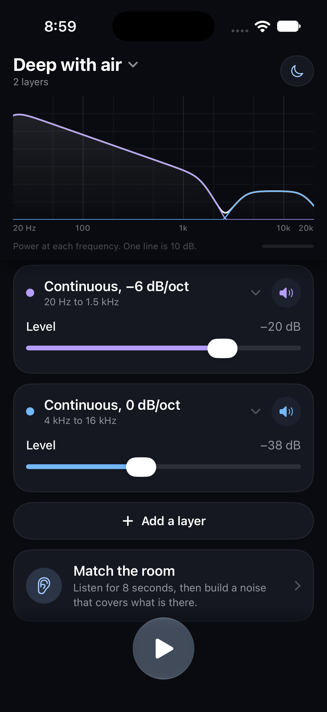
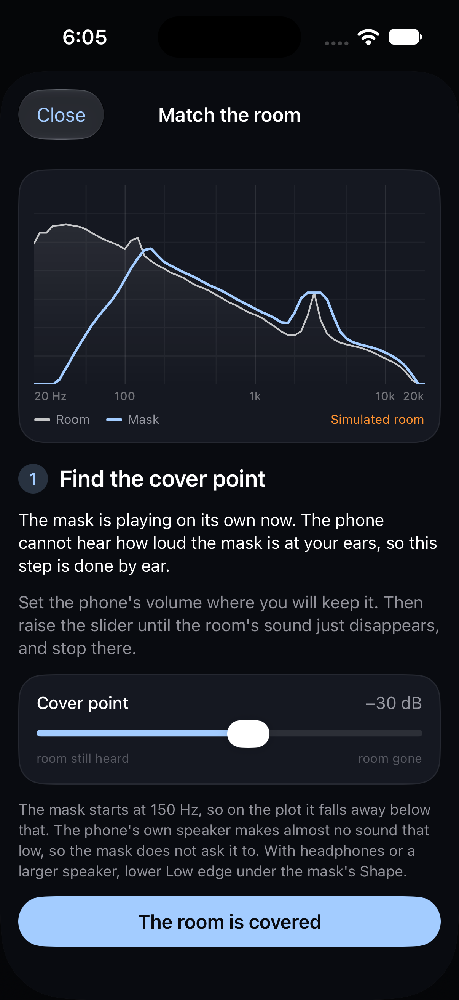

# Hush

A static noise generator for iPhone. There are no noise colours to pick from. A sound is built
from four principles, and every kind of steady static comes from the same sliders.
Hush can also listen to the room and shape a noise that covers what it heard.

| The mix | Matching the room |
|---|---|
|  |  |

## The four principles

A sound is up to 6 layers added together. Every layer has the same four parts.

| Principle | Controls | What it sets |
|---|---|---|
| **Texture** | Density, 1 to 48,000 events a second | What the noise is made of. At the top every sample is a new random value, which is a smooth static. Lower down there is silence between events, so each one is heard as a tick. |
| **Shape** | Tilt (dB per octave), low edge, high edge, one resonance (frequency, strength, sharpness) | Which frequencies the noise holds. Each tick takes its sound from the shape too: a deep shape makes thumps, a thin one makes clicks. |
| **Motion** | Rate, pattern, rise, delay, then swell, sweep and drift | How the noise changes over time. One slow signal rises to a crest and falls to a trough. Swell makes the crest louder, sweep makes it brighter or darker, drift moves the resonance up or down in pitch. |
| **Space** | Width, 0 to 100% | How alike the two ears are. At 0% both ears get the same noise. At 100% each ear gets its own. |

The plot at the top of the screen draws power against frequency, 10 dB per gridline, 20 Hz to
20 kHz. One line per layer, and a white line for the sum. A shaded band shows how far motion
swings a layer.

### Where the noise colours went

A colour is one position of the tilt slider, with everything else left alone.

| Colour | Tilt | Meaning |
|---|---|---|
| White | 0 dB/octave | The same power at every frequency |
| Pink | −3 | The same power in every octave |
| Brown (red) | −6 | Power falls to a quarter each octave |
| Blue | +3 | Power doubles each octave |
| Violet | +6 | Power quadruples each octave |

The slider runs from −12 to +12, so everything between and beyond these is available.
Grey noise follows the ear's sensitivity curve, which is not a straight line. Hush can only
get near it, by stacking layers.

## Match the room

1. **Listen.** Hush stops its own noise and records the room for 8 seconds. It measures how
   much power the room has in each of 61 bands, six to an octave, from about 20 Hz to 20 kHz.
   The recording is measured and dropped. Nothing is saved or sent.
2. **Find the cover point.** A new layer, the room mask, plays alone. It has the room's shape.
   You raise its level until the room just disappears.
3. **Add the margins.** *Louder by* lifts the mask above the cover point (6 dB to start).
   *Wider by* spreads every peak the room had to each side (a third of an octave to start),
   so a hum that shifts pitch stays covered.

Why step 2 is done by ear: the phone knows the room's level at its microphone, but it cannot
know how loud its own output is at your ears. That depends on the volume setting and on the
speaker or headphones. So the microphone gives the shape, and you give the level.

What the level margin buys: a steady room sound under a mask that is M dB louder adds
`10·log10(1 + 10^(−M/10))` dB to what you hear. At 6 dB that is 1.0 dB, about the smallest
change in loudness an ear can pick out.

Limits:

- It covers steady sounds: traffic, a fan, a hum, talk in the next room. A door slam is far
  louder than the room's average, and no mask at a comfortable level covers it.
- On the phone's own speaker the mask starts at 150 Hz, because that speaker makes almost no
  sound below it. With headphones it starts at 50 Hz. The low edge slider changes it.
- The iOS Simulator has no working microphone. There, Hush measures a made-up test room
  (rumble, a 120 Hz hum, a whine at 2.8 kHz and hiss) and marks it "Simulated room".

## Scenes (switched off)

Hidden behind `Features.scenes` in `Hush/Model/Library.swift`, because neither sounded real when heard.
The engine and its tests are still in the code.

A scene is a sound made of separate events, which layers of steady noise cannot make. A sound can hold
one scene next to its layers. Each scene has a level and its own sliders.

| Scene | What makes the sound | Sliders |
|---|---|---|
| **Train to somewhere** | Rails are 18.3 m long with a joint between them. Six axles sit where they would on real carriages, and each one clacks when it crosses a joint. A hit rings the carriage body at seven fixed low pitches and lifts the rumble for a moment. Under that: floor rumble, steel rolling on steel, air. | Speed, Clack, Rumble, Window (sealed cabin to open window), Journey (how often a bridge, a tunnel, points or welded rail comes) |
| **Fireplace** | Crackles are short bursts of noise, each with its own size, pitch and length. They arrive at random, and some set off a quick run of small ones. Under that: hiss that comes and goes, and a low roar that flutters a few times a second and jumps on a big pop. | Crackle, Pop size, Hiss, Roar, Distance, Mood (steady burn to flares and lulls) |

The level of a scene sets its loudest moments, not its average, because a scene is quiet between events.

## Other features

- Plays with the screen locked and from the lock-screen controls.
- Sleep timer, 15 minutes to 2 hours, with a 30-second fade at the end.
- Save and name your own sounds. Eleven starting points to open and take apart: Deep static,
  Rumble, Low rumble, Vacuum, Submarine, Ship's cabin, Waves, Distant surf, Propeller plane, Space station, Air conditioning.
- The sound being edited is kept between launches.

## Run it

In the Simulator:

```bash
xcodegen generate && xcodebuild -project Hush.xcodeproj -scheme Hush -destination 'platform=iOS Simulator,name=iPhone 17' build
```

On a phone: open `Hush.xcodeproj` in Xcode, pick the phone, and press Run. The command-line
way is in `CLAUDE.md`. Use a Release build to judge the sound, so the audio code is optimised.

Tests for the sound engine (they run on the Mac, no Simulator needed):

```bash
cd NoiseKit && swift test --scratch-path /Volumes/9100PRO/Developer/Xcode/DerivedData/Hush-NoiseKit-spm
```

## How the sound is made

`NoiseKit` is a Swift package with no UI. Each layer is rendered in two stages.

1. **In blocks of 4096 samples.** Make the raw material: a random value per sample, or mostly
   zeros with a tick now and then. Filter it to the layer's shape by multiplying spectra
   (FFT of 8192). The filter is designed from the sliders as a minimum-phase filter, so a tick
   starts sharply and rings afterwards, never before.
2. **Per sample.** Blend between the trough and crest filters (sweep), apply the resonance
   with its moving frequency (drift), apply the loudness swing (swell), mix the two ears
   (width), and smooth level changes over 40 ms.

The layers are summed, then pass a soft limiter that leaves anything under 80% of full scale
untouched. The audio thread never allocates or waits on a lock. Six heavy layers use about 1%
of one core on an M4.

The tests check the output against the sliders: tilt slope and level, where the resonance
lands, how alike the ears are, tick counts, swell rate, sweep, and that a room mask covers
the room it was built from.

## Layout

```
NoiseKit/            the sound engine and room analysis (Swift package, tested on the Mac)
  Model.swift        Sound, Layer and the four principles
  Scene.swift, SceneKernel.swift   the train and the fireplace
  NoiseKernel.swift  the audio-thread renderer
  FilterDesigner.swift, RealFFT.swift, Spectrum.swift, NoiseSynth.swift, RoomAnalyzer.swift
Hush/
  Audio/             Player (playback, lock screen, interruptions), RoomListener (microphone)
  Model/             AppModel, Library (saving, starting points), Describe (slider wording)
  Views/             MixScreen, LayerCard, SceneCard, MatchRoomSheet, SoundsSheet, SpectrumPlot
scripts/make-icon.swift   draws the app icon
project.yml          xcodegen project definition
```

## What has been heard

Patrick listens on an iPhone 14 Pro Max. Liked so far: Deep static, Rumble, Vacuum, Low rumble, Submarine,
Distant surf, Propeller plane.
Rejected: anything made of ticks (rain, fire), wind, a fan, the brighter statics, plane cabins,
a distant jet. Waves were "ok-ish but artificial" twice. Motion now has a quick rise with a
decaying fall, random cycle lengths, and a shared clock with a Delay slider, so one wave is a
low surge, a crash and a fizz in order.

## Not tested yet

- Both scenes (train, fireplace) have not been heard. They were checked by tests and by looking at
  spectrograms: the train's loudness repeats once per rail, the fire shows crackles of mixed sizes in bursts.
- The latest Waves, Ship's cabin, Space station and Air conditioning have no verdict yet.
- Room matching against the real microphone. In the Simulator it has only run against the
  simulated room.
- Background play, the lock-screen controls and interruptions (a call, unplugging headphones)
  on a real phone.
